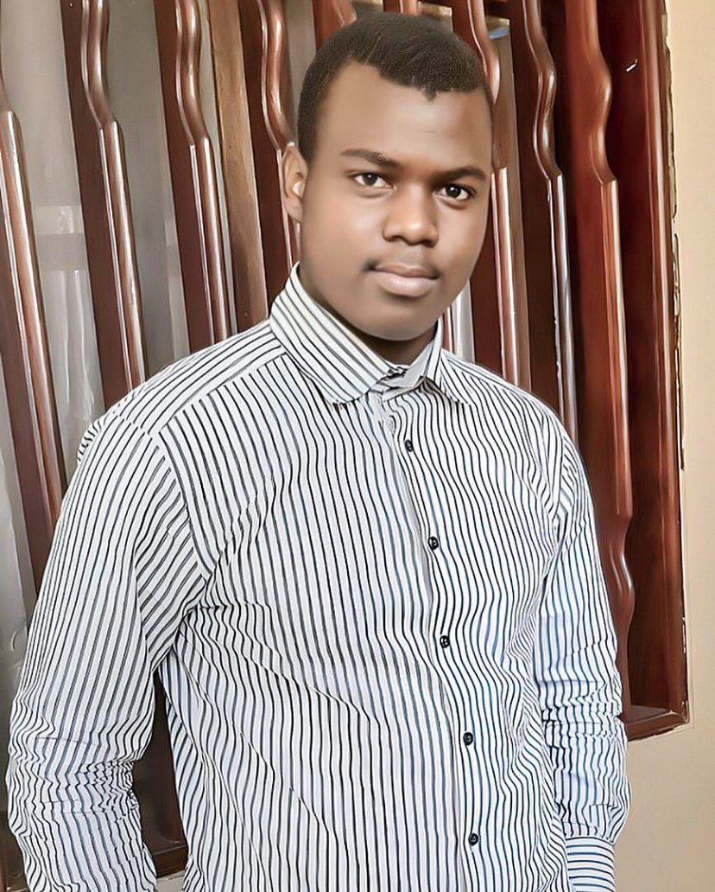

<!DOCTYPE html>
<html lang="fr">
<head>
<meta charset="UTF-8">
<meta name="viewport" content="width=device-width, initial-scale=1.0">
<title>Amadou Ba — Économiste | Économétrie & analyse de données</title>
<meta name="description" content="Portfolio d'Amadou Ba — Économie appliquée, économétrie et analyse de données.">
<meta property="og:type" content="website">
<meta property="og:locale" content="fr_FR">
<meta property="og:title" content="Amadou Ba — Économiste">
<meta property="og:description" content="Économie appliquée, économétrie et analyse de données.">
<meta property="og:image" content="https://amadouba211019.github.io/AmadouBa/photo.jpg">
<meta property="og:url" content="https://amadouba211019.github.io/AmadouBa/">
<link rel="icon" href="data:image/svg+xml,<svg xmlns='http://www.w3.org/2000/svg' viewBox='0 0 100 100'><rect width='100' height='100' fill='%23111'/><text x='50' y='68' font-size='52' text-anchor='middle' fill='%23fff' font-family='sans-serif' font-weight='bold'>AB</text></svg>">
<link rel="preconnect" href="https://fonts.googleapis.com">
<link rel="preconnect" href="https://fonts.gstatic.com" crossorigin>
<link href="https://fonts.googleapis.com/css2?family=DM+Sans:wght@400;500;600;700&family=Manrope:wght@600;700;800&display=swap" rel="stylesheet">
<link rel="stylesheet" href="https://cdnjs.cloudflare.com/ajax/libs/font-awesome/6.5.2/css/all.min.css">

</head>
<body>

<nav>

<a href="#accueil" class="logo">AMADOU BA</a>
<button class="burger" id="burger" aria-label="Ouvrir le menu" aria-expanded="false"><i class="fa-solid fa-bars"></i></button>
<ul class="nav-links" id="menu">
<li><a href="#about">À propos</a></li>
<li><a href="#travaux">Travaux</a></li>
<li><a href="#labs">Labs</a></li>
<li><a href="#formation">Formation</a></li>
<li><a href="#ecrits">Écrits</a></li>
<li><a href="#experience">Expérience</a></li>
<li><a href="#contact">Contact</a></li>
</ul>

</nav>

<header class="hero" id="accueil">

ÉCONOMIE APPLIQUÉE · ÉCONOMÉTRIE · ANALYSE DE DONNÉES

<h1>Économie.Données.Décision.</h1>

J’analyse les données économiques, construis des modèles économétriques et transforme les résultats en informations utiles.

Je suis <strong>Amadou Ba</strong>, titulaire d’un <strong>Master 2 en Analyse économique et quantitative</strong> à l’Université Gaston Berger de Saint-Louis. Je m’intéresse à l’économie appliquée, à l’économétrie, aux finances publiques et à l’analyse des politiques économiques.

Analyse des donnéesSuivi-évaluationGestion de projets

<a href="#travaux" class="btn">Voir mes travaux <i class="fa-solid fa-arrow-down"></i></a>

</header>

<section class="stats">

Master 2

Analyse économique et quantitative

Université Gaston Berger, Saint-Louis

Sénégal

Terrain d’étude

Dette publique et investissement

Économétrie

Outils

Stata · R · EViews · Scilab

Recherche

Mémoire

Efficacité de l’endettement du Sénégal

</section>

<section id="about">

01 / ABOUT
<h2 class="section-title">À propos</h2>

Profil

Mon orientation actuelle est l’analyse économique quantitative, avec un intérêt particulier pour l’économétrie, les données macroéconomiques et les politiques publiques.

Je travaille avec <strong>Stata, R, EViews, Scilab et Excel</strong> pour traiter, analyser et interpréter des données économiques.

Je m’intéresse notamment à la dette publique, à la croissance, aux finances publiques et aux questions de développement.

Je cherche à transformer les données et les résultats économétriques en analyses claires et utiles à la décision.

StataREViewsScilabExcelÉconométrieAnalyse des donnéesSuivi-évaluationGestion de projetsSéries temporelles

</section>

<section class="projects" id="travaux">

02 / SELECTED WORK
<h2 class="section-title">Travaux</h2>

<article class="project">

01

Recherche économique · Économétrie

<h3>L’impact de la dette publique sur l’investissement</h3>

Étude économétrique consacrée à l’analyse de l’impact de la dette publique sur l’investissement au Sénégal.

L’objectif est d’examiner la relation entre l’endettement public et l’investissement à partir de données macroéconomiques, en mobilisant des outils d’analyse économétrique et de séries temporelles.

StataÉconométrieSéries temporellesDette publiqueInvestissement

<a class="project-link" href="soutenance-amadou-ba.pdf" target="_blank" rel="noopener">Voir la présentation (PDF) <i class="fa-solid fa-arrow-up-right-from-square"></i></a>

</article>

<article class="project">

02

Analyse économique · Recherche

<h3>Dette publique &amp; croissance économique</h3>

Une analyse de la relation entre l’endettement public, la croissance économique, l’investissement et plusieurs variables macroéconomiques.

StataRégressionDonnées macroéconomiquesAnalyse quantitative

</article>

<article class="project">

03

Gestion · Suivi-évaluation

<h3>Suivi &amp; évaluation de projets</h3>

Travaux et intérêt professionnel autour du suivi, de l’évaluation et de la gestion de projets, avec une approche orientée vers les données et les indicateurs de résultats.

Gestion de projetSuivi-évaluationExcelAnalyse

</article>

</section>

<section class="labs" id="labs">

03 / LABS &amp; ANALYSES
<h2 class="section-title">Labs</h2>

01
<h3>Dette publique du Sénégal</h3>
Analyses et visualisations autour de l’évolution de la dette publique, du déficit et de leurs implications pour les finances publiques.

Économie publiqueDonnéesAnalyse quantitative
<a class="lab-link" href="analyse-dette-senegal.pdf" target="_blank" rel="noopener">Lire l’analyse (PDF) <i class="fa-solid fa-arrow-up-right-from-square"></i></a>

02
<h3>Énergie &amp; finances publiques</h3>
Réflexions quantitatives sur les subventions énergétiques, les dépenses publiques et les mécanismes de financement.

Économie de l’énergiePolitiques publiquesDonnées

03
<h3>Économétrie appliquée</h3>
Expérimentations et analyses utilisant des modèles économétriques pour étudier des phénomènes économiques.

StataREViewsSéries temporelles

</section>

<section class="education" id="formation">

04 / EDUCATION
<h2 class="section-title">Formation</h2>

2024 — 2025

<h3>Master 2 — Analyse économique et quantitative</h3>
Formation en analyse économique, économétrie, statistiques et méthodes quantitatives.

Université Gaston Berger Saint-Louis

2023 — 2024

<h3>Master 1 — Analyse économique et quantitative</h3>
Première année de master : économie, statistiques et méthodes quantitatives.

Université Gaston Berger Saint-Louis

2021 — 2023

<h3>Licence — Économie appliquée</h3>
Formation en économie appliquée et analyse économique.

Université Gaston Berger Saint-Louis

Baccalauréat

<h3>Baccalauréat</h3>
Diplôme de fin d’études secondaires.

Sénégal

</section>

<section id="ecrits">

05 / ANALYSES
<h2 class="section-title">Écrits</h2>

<h3>Analyses économiques</h3>
Dette publique · Croissance · Finances publiques

<h3>Recherche</h3>
Économétrie · Politiques publiques · Données

</section>

<section class="experience" id="experience">

06 / EXPERIENCE
<h2 class="section-title">Expérience</h2>

Tivaouane Basket Club

<h3>Comptable</h3>
Suivi des dépenses et recettes, élaboration de bilans financiers et de rapports budgétaires, avec appui à la prise de décision financière.

2023 — 2024

Tivaouane Basket Club

<h3>Community Manager</h3>
Gestion et animation des réseaux sociaux, promotion des activités sportives et contribution à la mobilisation des supporters et partenaires.

2023 — 2024

Association And Defar Ndoutt

<h3>Vice-président</h3>
Coordination d’activités communautaires et sociales, participation à la gestion de projets locaux et actions de solidarité.

2020 — 2022

</section>

<section class="contact" id="contact">

<h2>Construisons quelque chose d’utile.</h2>

Vous avez un projet d’étude, une analyse économique, une mission de suivi-évaluation ou un projet nécessitant une approche quantitative ?

Follow me on

<a href="https://x.com/amadou_at_tijan?s=11" target="_blank" rel="noopener noreferrer" class="social" aria-label="X"><i class="fa-brands fa-x-twitter"></i></a>
<a href="https://www.linkedin.com/in/amadou-ba-037159374/" target="_blank" rel="noopener noreferrer" class="social" aria-label="LinkedIn"><i class="fa-brands fa-linkedin-in"></i></a>
<a href="https://www.facebook.com/share/1Lmk3AGCWk/" target="_blank" rel="noopener noreferrer" class="social" aria-label="Facebook"><i class="fa-brands fa-facebook-f"></i></a>
<a href="https://www.instagram.com/amadou_at_tijani/" target="_blank" rel="noopener noreferrer" class="social" aria-label="Instagram"><i class="fa-brands fa-instagram"></i></a>

<a href="mailto:amadouba211019@gmail.com" class="contact-link">amadouba211019@gmail.com</a>
<a href="tel:+221772503248" class="contact-link">+221 77 250 32 48</a>

</section>

<footer>

AMADOU BA

© 2026 Amadou Ba — Économie appliquée &amp; analyse quantitative

</footer>

</body>
</html>
